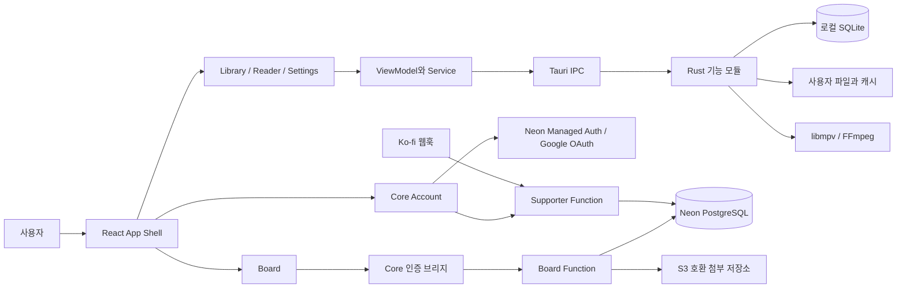
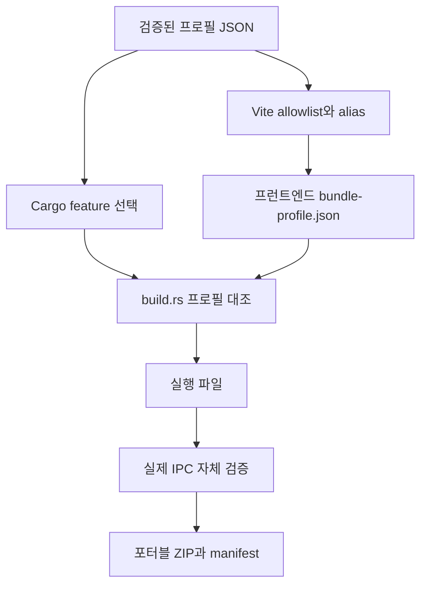

# 시스템 설계와 기술스택

## 전체 구조

데스크톱 애플리케이션 내부는 기능 모듈을 가진 하나의 프로세스로 구성한다. 온라인 게시판과 후원 확인은 별도 Functions 서비스다. 따라서 전체 시스템을 하나의 Monolith라고 부르기보다, **데스크톱 내부 Modular Monolith + 외부 서비스**로 설명하는 편이 정확하다.

사용자 라이브러리 파일과 SQLite를 클라우드 계정 데이터베이스로 합치지 않는다. 서비스 연결 실패와 로컬 열람의 책임을 분리하기 위해서다.

## Core와 기능 모듈

| 책임 | 소유 위치 |
| --- | --- |
| 공통 메뉴·테마·창 닫기·계정 대화상자 | `src/App.tsx`, `features/account/` |
| 플러그인 계약·등록·의존성·프로필 | `plugin-sdk/`, `plugin-host/` |
| 책장 화면·탐색 상태·스캔 요청·썸네일 | `plugins/library/` |
| 이미지·문서·영상 Reader와 보기 정책 | `plugins/reader/` |
| 설정 UI와 기능별 섹션 | `plugins/settings/` |
| 게시판 모델·클라이언트·뷰 | `plugins/board/` |
| DEV 외부 플러그인 모델·관리·격리 화면 | `plugins/external/` |
| 파일·SQLite·네이티브 창·미디어 IPC | `src-tauri/src/` |
| 온라인 권한·게시글·첨부 처리 | `services/board-api/` |
| 웹훅·후원 상태 판정 | `services/supporter-api/` |

## 기술 선택

| 기술 | 적용 목적 | 선택의 이점과 비용 |
| --- | --- | --- |
| Tauri 2 / Rust | 데스크톱 셸, IPC, 파일·SQLite·Win32 연동 | 웹 UI와 네이티브 처리의 경계가 명확해지지만 비동기·스레드·수명주기를 함께 다뤄야 함 |
| React / TypeScript | 화면, 상태 표현, typed 서비스 계약 | 기능별 UI 조합이 쉽지만 거대한 View와 Core 상태가 생기지 않도록 관리가 필요 |
| Vite | 개발 서버, 선택적 번들, 출처 stamp | 빌드 시점 제외와 manifest 검증이 가능하며 생성 바이너리 감시 제외가 필요 |
| SQLite / rusqlite | 로컬 책장·열람 이력 | 서버 없이 동작하며 기존 스키마 호환·파일 변경과 DB 갱신의 일관성이 중요 |
| libmpv / FFmpeg / image | 영상·자막, 영상 썸네일, 이미지 처리 | 미디어 엔진을 재사용하지만 DLL 수명·장치 차이·배포 라이선스를 관리해야 함 |
| Neon Managed Auth / Google OAuth | 계정과 세션 | 인증 서비스를 재사용하고 OAuth 콜백과 세션 검증을 구분해야 함 |
| Neon PostgreSQL / Functions | 게시판·관리자·후원 데이터와 API | 데스크톱에 DB 비밀값을 넣지 않고 서버에서 권한 판정 가능 |
| Tiptap / ProseMirror | 게시글 리치 텍스트 | 구조화된 문서를 저장하며 서버에서 허용 노드·속성을 다시 검증해야 함 |
| pg / jose / S3 SDK | 서버 SQL, JWT, 첨부 저장소 | 검증 가능한 서버 경계를 만들지만 인증·DB·객체 정리 실패를 처리해야 함 |

실제 잠금 버전은 [의존성 인벤토리](../legal/THIRD_PARTY_DEPENDENCIES.md)에 별도로 기록했다. 선언된 버전 범위와 실제 설치 버전을 혼동하지 않는다.

## DEV와 RELEASE의 구조적 분리

`portfolio-dev`와 `custom-release`는 같은 주요 기능 소스를 공유한다. DEV는 `dev-selective`와 `dev-plugin-manager`를 사용한다. RELEASE는 `native-selective`를 사용하며 개발자 관리자 feature와 함께 컴파일할 수 없도록 제한한다.

프런트엔드의 관리자 모듈은 RELEASE에서 inert 모듈로 대체하고 번들 검사로 잔여 코드가 포함되지 않았는지 확인한다. Rust는 조건부 모듈·명령 등록으로 관련 IPC를 제외한다. `localStorage`의 메뉴 표시 상태는 네이티브 권한을 결정하지 않는다.

## 플러그인 구조의 두 범위

내장 플러그인은 배포에 함께 들어가는 신뢰된 메뉴·기능 모듈이다. manifest는 ID, 버전, Host API 버전, 의존성, 메뉴 순서, mount 정책을 선언한다. Registry는 충돌, 버전 범위, 누락·순환 의존성을 검증한다.

DEV의 외부 플러그인 관리에는 JSON 및 격리 JavaScript 패키지, 게시자 Ed25519 검증, 제한된 Host API가 있다. 임의 Rust 모듈이나 unrestricted npm 패키지를 로드하는 구조로 설명하지 않는다. 기본 사용자 RELEASE에는 이 관리 표면이 포함되지 않는다.

## 데이터와 보안 경계

- 로컬 SQLite 경로와 사용자 파일은 기존 경로를 유지한다.
- OAuth 콜백은 인증 완료 증거가 아니며, Neon 세션 확인 결과로 계정을 갱신한다.
- 게시판 서버는 JWT를 검증하고 DB에서 관리자·작성자 권한을 판단한다.
- 후원 여부는 검증된 사용자와 서버 DB의 기록으로 판단한다.
- DB 연결 문자열, Ko-fi 검증 토큰, 객체 저장소 비밀값은 서버 환경에만 둔다.
- Google 로그인에 필요한 로컬 loopback 콜백은 제거한 모바일 원격 서버와 목적·수명이 다르다.

## 현재의 한계

App Shell과 일부 View에는 아직 상당한 상태·조합 로직이 있다. 모든 코드가 완전한 MVVM이나 엄격한 DDD를 따르는 것은 아니다. 네이티브 스캔·파일 변경도 하나의 거대한 분산 트랜잭션으로 처리하지 않으며, 보존·복구·충돌 처리와 회귀 테스트로 위험을 줄이는 접근이다.

## 구현 근거

- [프로필 검증](../../desktop-tauri/src/plugin-host/pluginBuildProfile.ts)
- [Vite 구성](../../desktop-tauri/vite.config.ts)
- [Rust 빌드 검증](../../desktop-tauri/src-tauri/build.rs)
- [명령 등록](../../desktop-tauri/src-tauri/src/lib.rs)
- [실행 파일 자체 검증](../../desktop-tauri/src-tauri/src/release_self_test.js)
- [Neon 서비스](../../services)
