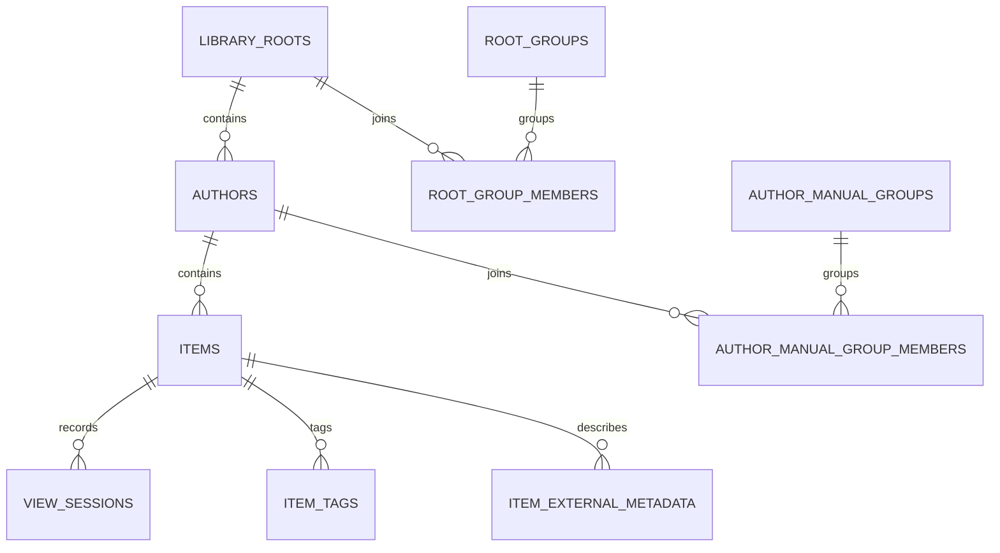
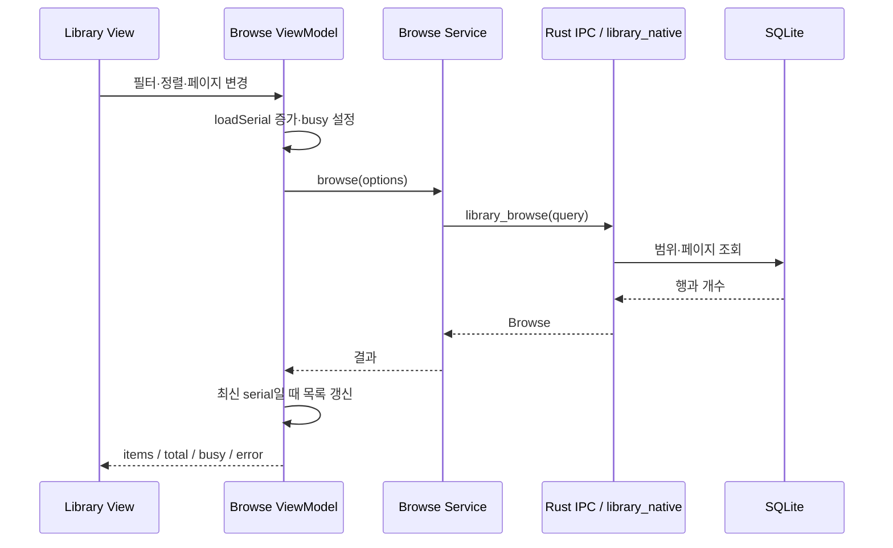
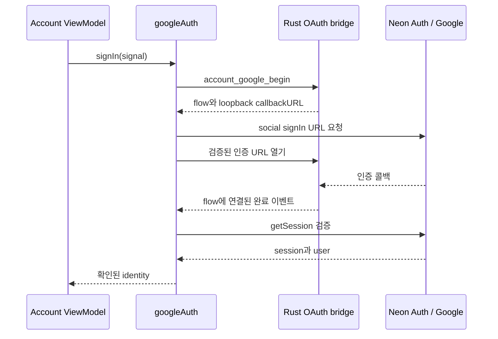

# 모델과 서비스 구현

## 데이터 책임

로컬 모델은 파일과 열람 상태를 나타내고, 온라인 모델은 인증된 사용자의 게시글·권한·후원 상태를 나타낸다. 데스크톱이 PostgreSQL에 직접 SQL을 실행하거나 클라우드 DB 자격 증명을 보관하는 방식은 사용하지 않는다.

## 로컬 SQLite 모델

| 모델·테이블 | 주요 데이터 | 책임 |
| --- | --- | --- |
| `library_roots` | path, name, last_scanned_at, missing | 등록된 탐색 시작점 |
| `root_groups`, `root_group_members` | 그룹과 루트 구성·순서 | 여러 루트의 논리적 묶음 |
| `authors` | root_id, path, name, 집계·스캔 signature | 작가 단위 목록과 증분 스캔 상태 |
| `author_manual_groups`, 구성원 | 작가 묶음·순서 | 물리 폴더를 바꾸지 않는 논리적 구성 |
| `items` | author_id, path, kind, 크기·mtime, 태그 관련 조회, 열람 위치 | 작품 식별과 열람 상태 |
| `view_sessions` | item_id, 열고 닫은 시각, 시작·종료 페이지 | 열람 세션 기록 |
| `item_external_metadata`, `item_tags` | 과거 메타데이터·태그 | 로컬 검색과 기존 자료 호환 |
| `app_state` | key/value | 기존 앱 상태 |

과거 온라인 통계 테이블은 호환성을 위해 남아 있다. 이 테이블의 존재가 온라인 검색·수집 기능의 제공을 뜻하지 않는다. 정식 데이터 모델의 최종 기준은 [SQLite 스키마](../../desktop-tauri/src-tauri/src/library_schema_native.rs)다.

## Library의 상태 모델

`Mode`는 roots, authors, items, all_items 탐색 상태를 나타낸다. `ShelfPosition`은 페이지, 카드 ID·index, 검색어·태그·정렬 방향·페이지 크기 등을 보관한다. `libraryScopeKey`는 현재 조회 범위를 식별한다.

`useLibraryBrowseViewModel`은 비동기 조회, 로딩·오류, 수동 그룹 보조 조회, refresh generation과 오래된 응답 차단을 소유한다. `libraryBrowseService`는 조회 조건을 네이티브 IPC 계약으로 바꾼다. Rust의 `library_native`는 SQLite 쿼리와 결과를 담당한다.

이 직렬 번호는 늦은 응답의 UI 덮어쓰기를 막는 장치다. DB 트랜잭션이나 모든 네트워크 요청의 실제 취소를 대신하지 않는다.

## 스캔과 파일 변경

프런트엔드의 Scan ViewModel·Service와 Rust의 live/fast/root scan 모듈이 협력한다. 진행 상태는 이벤트와 상태 조회로 표현하고 취소 토큰으로 중단을 요청한다. 파일 이동·휴지통 처리·스캔 갱신에서는 작품 식별과 기존 열람 상태를 보존하는 테스트를 둔다.

파일 시스템 변경과 SQLite 갱신의 모든 실패가 자동 복구된다고 가정하지 않는다. 취소, 대상 이름 충돌, 누락 파일과 대규모 스캔은 수동 테스트에서도 확인해야 한다.

## Reader와 미디어 서비스

| 구성 | 역할 |
| --- | --- |
| `ReaderRenderPort` | Core가 Library에 제공하는 Reader 조합 계약 |
| `readerNativeService` | Reader·로컬 재생 관련 네이티브 호출 집약 |
| `library_reader` | 로컬 작품 열기·페이지 열거·페이지 데이터·이동·진행 기록 |
| `readerVirtualPageList`, `ReaderVirtualPagePicker` | 큰 페이지 목록에서 표시·조회 범위를 제한 |
| `readerWebtoonWindow` | 긴 웹툰의 활성 표시 구간 계산 |
| `readerViewPresets` | manga·webtoon·auto 보기 정책과 저장 값 정규화 |
| `libmpv_native`, `player_subtitles` | 플레이어 세션·창·재생·자막·폰트 제어 |
| `useLibmpvMultiview` | 여러 로컬 영상 세션의 UI 조합 |

libmpv 명령에는 세션 키와 창 소유권 검증이 사용된다. 오래된 세션의 조작이 새 플레이어에 적용되지 않도록 하는 경계다. 현재 잠금 오류는 수동 검증 이슈로 남아 있으며, 엔진의 전체 안정성을 보증하지 않는다.

## 설정 저장

| 값 | 위치·키의 예 | 보존 의도 |
| --- | --- | --- |
| 책장 탐색·표시 설정 | `nvideo-library-v2` | 목록과 필터 복귀 |
| Reader 프리셋 | `nvideo-reader-view-presets-v1` | 모드별 zoom·fit·방향 유지 |
| 활성 Reader 모드 | `nvideo-reader-view-active-v1` | 재열기 시 보기 상태 |
| 테마 | `nvideo-theme` | 밝고 어두운 화면 선택 |
| libmpv 관련 설정 | `nvideo-libmpv-*` 키들 | 재생·표시·조작 선호 |

설정은 같은 창에서도 알림을 전파한다. 기능 제거를 이유로 저장소 전체를 초기화하지 않았다. WebView 데이터와 SQLite는 서로 다른 저장 계층이므로 백업·이전 시 함께 고려해야 한다.

## 계정 모델과 OAuth

`AccountIdentity`는 signedIn, userId, email, name, plan, provider를 표현한다. plan은 guest/free/supporter다. 현재 UI의 로그인 진입점은 Google이다. 기존 Rust 이메일 인증 함수의 존재와 사용자에게 노출되는 회원가입 기능은 구분한다.

로그인 취소·시간 초과·늦은 응답 처리와 URL 호스트 검증이 있다. Rust의 native 세션과 Google SDK의 세션 경로가 함께 존재하므로 모든 세션이 메모리에만 저장된다고 일반화하지 않는다. 비밀번호·OAuth verifier·쿠키·JWT를 로그나 문서 예시에 넣지 않는다.

## 게시판 모델과 API

`BoardSummary`는 목록용 title·summary·locked·isNotice 등을 포함한다. `BoardPost`는 본문·첨부·작성자·viewer 권한을 포함한다. 리치 텍스트는 기존 version 1 block 모델과 version 2 Tiptap document 모델을 구분한다.

| 클라이언트 서비스 | API 책임 |
| --- | --- |
| list / detail | 검색·페이지·카테고리·조회자 권한을 반영한 조회 |
| create / edit | 회원 확인, 본문·리치 문서·이미지 검증 |
| delete | 작성자 또는 관리자 권한, 게시글·첨부 정리 |
| notice | DB에서 확인한 관리자만 공지 변경 |
| report | 로그인한 사용자의 신고와 중복 제어 |

`boardService` → `account_board_request` → Board Function 경계로 요청한다. Google 회원은 인증 토큰을 전달하며 서버는 JWT와 DB 사용자 정보를 확인한다. UI 버튼 표시만으로 작성·삭제 권한을 결정하지 않는다.

클라우드 테이블은 `nvideo_board.posts`, `reports`, `admins`다. posts에는 secret, rich_content, is_notice와 공지 시각이 추가되어 있다. 비밀글의 목록 정보는 권한에 따라 마스킹하고, 허용되지 않은 상세 조회는 존재 여부를 드러내지 않는 방식으로 응답한다. 비밀 첨부는 private 저장 경로를 사용한다. 현재 댓글 테이블과 댓글 API는 확인되지 않았다.

## 후원 서비스

`POST /webhooks/kofi`는 검증 토큰·요청 크기·결제 payload를 확인하고 transaction/message 고유키로 중복을 방지한다. 저장 항목은 이메일·금액·통화·결제 식별자·시각·철회 시각이다. 원본 웹훅 전체나 후원 메시지를 그대로 저장하지 않는다.

`GET /supporter`는 JWT를 검증하고 해당 사용자의 현재 검증된 이메일과 철회되지 않은 후원 기록을 비교한다. 데스크톱은 응답 userId가 현재 로그인 사용자와 같은지 다시 확인한다. 후원 여부와 관리자 권한은 독립적이다.

현재 데이터 모델은 자동 갱신 청구·구독 만료·환불 처리 전체를 구현한 과금 시스템이 아니다. 이 차이는 [수익화 아이디어](../business/06-monetization.md)의 출발점이다.

## 소스 안내

[Library 모델](../../desktop-tauri/src/plugins/library/model/libraryModel.ts), [Browse 서비스](../../desktop-tauri/src/plugins/library/services/libraryBrowseService.ts), [Reader 서비스](../../desktop-tauri/src/plugins/reader/services/readerNativeService.ts), [계정 서비스](../../desktop-tauri/src/features/account/services/accountService.ts), [Google 인증](../../desktop-tauri/src/features/account/services/googleAuth.ts), [게시판 서비스](../../desktop-tauri/src/plugins/board/services/boardService.ts), [Board API](../../services/board-api/index.mjs), [Supporter API](../../services/supporter-api/index.mjs).
